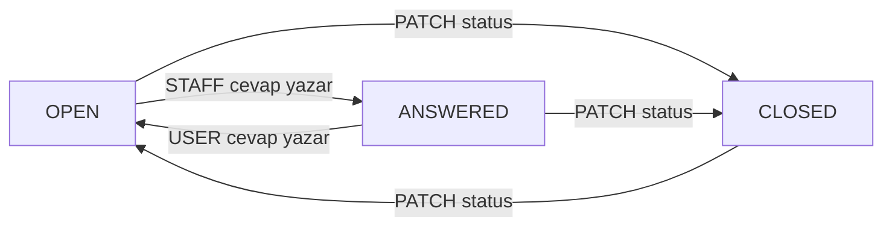

# support-lib

[](https://jitpack.io/#Furkanaksu/support-lib)

Ktor + Exposed tabanlı, **yeniden kullanılabilir support (destek talebi) kütüphanesi**.
Bir kez yazılır, GitHub'a konur, her yeni projede bağımlılık olarak eklenip iki satırla çağrılır.

Altyapı `furkan.api` ile aynıdır: Gradle Kotlin DSL + version catalog, JDK 21, Kotlin 2.2.21,
Ktor 3.3.2, Exposed 0.61.0, kotlinx.serialization.

## Kritik tasarım kuralları

1. **DB kütüphane içinde `connect` edilmez.** Dışarıdan `Database` objesi alınır, her sorgu
   `transaction(database)` ile çalışır.
2. **Path sabit yazılmaz.** `basePath` parametriktir — `/support`, `/api/v2/destek` fark etmez.
3. **Her şey config'le enjekte edilir.** DB, path, tablo adı, auth hep `SupportConfig`'ten gelir;
   kütüphane hiçbir ortama özel şey bilmez.

## Kurulum (tüketen proje)

`settings.gradle.kts`:

```kotlin
dependencyResolutionManagement {
    repositories {
        mavenCentral()
        maven("https://jitpack.io")
    }
}
```

`build.gradle.kts`:

```kotlin
dependencies {
    implementation("com.github.Furkanaksu:support-lib:2.0.0")
}
```

## Kullanım

```kotlin
fun Application.module() {
    // Bu projenin KENDİ veritabanı
    val db = Database.connect(
        url = "jdbc:postgresql://localhost:5432/proje_a_db",
        driver = "org.postgresql.Driver",
        user = System.getenv("DB_USER"),
        password = System.getenv("DB_PASSWORD")
    )

    val supportConfig = SupportConfig(
        database = db,
        basePath = "/api/destek",        // base link bu projede farklı olabilir
        tableName = "prayapp_support"    // tablo adı da projeye özel
    )
    supportConfig.migrate()              // tabloyu bu DB'de oluştur

    install(ContentNegotiation) { json() }   // tüketen projenin sorumluluğu

    routing {
        supportRoutes(supportConfig)     // kullanıcı uçları
        authenticate("admin") {          // ekip uçlarını proje kendi yetkisiyle korur
            supportAdminRoutes(supportConfig)
        }
    }
}
```

### Yeni talepte yan etki (`onCreate`)

Kütüphane e-posta, Slack ya da log bilmez — ama yeni talep geldiğinde haber verir:

```kotlin
SupportConfig(
    database = db,
    tableName = "prayapp_support",
    onCreate = { talep ->
        // admin'e e-posta, Slack bildirimi, loglama...
        // Uzun süren işi kendi kapsamında başlat; kütüphane sonucu beklemez.
    }
)
```

Kayıt atıldıktan **sonra**, cevap dönmeden hemen önce çağrılır. Fırlattığı hata isteği
bozmaz: talep zaten kaydedilmiştir, istemciye yine `201` döner. Geçersiz istekte
(eksik alan) hiç çağrılmaz.

### Fotoğraf (opsiyonel)

Destek talebine fotoğraf eklenebilir. Kütüphane dosyayı **nereye koyacağını bilmez**;
depoyu proje bağlar:

```kotlin
SupportConfig(
    database = db,
    photoStorage = SupportPhotoStorage { bytes, fileName, contentType ->
        SupabaseStorageService.upload(fileName, bytes, contentType)   // adres döner
    },
    maxPhotoBytes = 5L * 1024 * 1024,                                  // varsayılan 5 MB
    allowedPhotoTypes = setOf("image/jpeg", "image/png", "image/webp") // varsayılan
)
```

`photoStorage` verilmezse özellik **kapalıdır**: fotoğraflı istek 400 alır.

İstemci iki yoldan birini kullanır:

**1. Dosyayı API'ye yükle** — `multipart/form-data`. Alan adları JSON'dakiyle aynı,
fotoğraf `photo` parçasında:

```
POST /support
Content-Type: multipart/form-data

deviceId=a1b2c3
email=ali@ornek.com
description=Uygulama açılmıyor
photo=<dosya>
```

**2. Kendi yükle, adresi gönder** — JSON gövdesine `photoUrl` ekle. Fotoğrafı kendi
deposuna koyan istemciler için.

Her iki durumda da cevapta `photoUrl` döner; liste ve detay uçlarında da görünür.
Fotoğrafsız istekler eskisi gibi çalışır, `photoUrl` null gelir.

Hata durumları: dosya çok büyükse **413**, tür desteklenmiyorsa **415**, depo
yapılandırılmamışsa **400**, depo erişilemezse **503** (talep oluşturulmaz, kullanıcı
fotoğrafsız tekrar deneyebilir). Üçünde de depoya gereksiz istek gitmez — doğrulama
yüklemeden önce yapılır, boyut sınırı aşılınca dosya okunmaya devam edilmez.

Kullanıcı uçlarına da auth istenirse, projenin kendi Authentication kurulumu kullanılır:

```kotlin
SupportConfig(database = db, requireAuth = true, authName = "auth-jwt")
```

## Uç noktalar

İki ayrı grup var. **Kullanıcı uçları** (`supportRoutes`, `basePath` varsayılanı `/support`) —
herkes yalnızca kendi cihazının taleplerini görür:

| Metot | Yol | Açıklama |
| --- | --- | --- |
| POST | `{basePath}` | Yeni talep — `deviceId`, `email`, `description` zorunlu |
| GET | `{basePath}/device/{deviceId}` | Kendi talepleri — durum, cevap sayısı, son cevap |
| GET | `{basePath}/device/{deviceId}/{id}` | Kendi talebinin detayı + tüm cevaplar |
| POST | `{basePath}/device/{deviceId}/{id}/replies` | Kendi talebine cevap (`USER`) — `message` zorunlu |

Talep başka cihaza aitse detay ve cevap uçları `404` döner.

**Ekip uçları** (`supportAdminRoutes`, `adminBasePath` varsayılanı `/admin{basePath}`) —
kütüphane bunları korumaz, proje kendi yetkisinin içine monte eder:

| Metot | Yol | Açıklama |
| --- | --- | --- |
| GET | `{adminBasePath}` | Sayfalı liste — `page`, `size`, `email`, `deviceId`, `status` |
| GET | `{adminBasePath}/{id}` | Detay: talep + tüm cevaplar |
| POST | `{adminBasePath}/{id}/replies` | Ekip cevabı (`STAFF`) — `message` zorunlu |
| PATCH | `{adminBasePath}/{id}/status` | Durum değiştir — `OPEN`, `ANSWERED`, `CLOSED` |
| DELETE | `{adminBasePath}/{id}` | Talebi sil (cevapları da silinir) |

`POST {basePath}` gövdesi:

```json
{
  "deviceId": "device-1",
  "email": "a@b.com",
  "description": "Uygulamada hata alıyorum",
  "location": "Istanbul",
  "latitude": 41.0,
  "longitude": 29.0
}
```

Koordinatlar hem sayı hem tırnaklı string kabul edilir (`41.0` veya `"41.0"`), böylece
gövdeyi string map olarak gönderen eski istemciler de çalışır.

## Durumlar ve cevaplama

Her talebin bir durumu vardır ve durum cevaplarla birlikte otomatik ilerler:

| Durum | Anlamı |
| --- | --- |
| `OPEN` | Yeni açıldı ya da son sözü kullanıcı söyledi — ekip cevabı bekleniyor |
| `ANSWERED` | Son cevabı destek ekibi yazdı |
| `CLOSED` | Kapatıldı (sadece `PATCH .../status` ile) |



Cevap gövdesi yalnızca mesajdır; yazarı uç belirler (ekip ucu `STAFF`, kullanıcı ucu `USER`):

```json
{ "message": "Konuyu inceledik, güncellemede düzeltilecek." }
```

Cevaba fotoğraf eklemek için gövde `multipart/form-data` olur: `message` alanı + `photo` dosyası
(talep oluştururken olduğu gibi aynı boyut ve tür sınırları). Fotoğraf varsa `message` boş
olabilir. Fotoğrafı kendi yükleyen istemci JSON'da `photoUrl` gönderebilir. Cevapta ve detaydaki
her cevapta `photoUrl` döner.

Detay cevabı, talebin tüm yazışmasını zaman sırasıyla döner:

```json
{
  "id": 12,
  "deviceId": "device-1",
  "status": "ANSWERED",
  "description": "Uygulamada hata alıyorum",
  "createdDate": "2026-09-20T12:00:00",
  "updatedDate": "2026-09-20T12:30:00",
  "replies": [
    { "id": 3, "supportId": 12, "message": "Konuyu inceledik.", "author": "STAFF", "createdDate": "2026-09-20T12:30:00" }
  ]
}
```

`GET {basePath}/device/{deviceId}` kullanıcının kendi taleplerini döner — `deviceId` tam eşleşir,
`?status=OPEN` ile filtrelenebilir. Her satırda `status`, `replyCount`, `lastReplyAuthor` ve
`lastReplyDate` bulunur. İstemci "yeni cevap var" bildirimini bunlarla verir: son cevap `STAFF`'tan
ve `lastReplyDate` daha önce gördüğü tarihten farklıysa okunmamıştır.

## Tablolar

Kütüphane iki tablo kullanır: `tableName` (talepler) ve `replyTableName` (cevaplar, varsayılan
`<tableName>_replies`). Cevap tablosu talebe `ON DELETE CASCADE` ile bağlıdır.
`migrate()` ikisini de oluşturur; var olan tabloya eksik kolonları ekler.

## Yayınlama (JitPack)

```bash
git tag 2.0.0
git push origin 2.0.0
```

## Sürüm notu

`2.1.0` cevaplara opsiyonel fotoğraf ekledi: cevap uçları `multipart/form-data` (`message` +
`photo`) kabul eder, `SupportReplyResponse.photoUrl` döner. Cevap tablosuna nullable `photo_url`
kolonu eklenir (`migrate()` halleder). Kırıcı değişiklik yok; JSON cevaplar aynen çalışır.

`2.0.0` **kırıcı**: ekip uçları kullanıcı uçlarından ayrıldı. Önceden herkese açık olan liste,
detay, cevap, durum ve silme uçları artık `supportAdminRoutes(config)` ile, `adminBasePath`
altında ve projenin yetkisi içinde monte edilir. Kullanıcıya kendi talebinin detayı ve cevabı için
`/device/{deviceId}/{id}` uçları geldi; cevap gövdesindeki `author` alanı kalktı. Listeye
`lastReplyAuthor` ve `lastReplyDate` eklendi. Tablo değişikliği yok.

`1.3.0` destek talebine opsiyonel fotoğraf ekledi: `SupportConfig.photoStorage`,
`multipart/form-data` gövde desteği ve `photoUrl` alanı. Tabloya nullable `photo_url`
kolonu eklenir (`migrate()` halleder). Kırıcı değişiklik yok; JSON gövdesi ve fotoğrafsız
istekler aynen çalışır.

`1.2.0` `SupportConfig.onCreate` kancasını ekledi: yeni talep oluşunca projeye haber verir
(admin e-postası, bildirim, log). Varsayılanı boş, kırıcı değişiklik yok.

`1.1.0` cevap yazma, durum akışı (OPEN → ANSWERED → CLOSED) ve cihaza göre listelemeyi ekledi.

Tag atıldıktan sonra JitPack ilk istekte derler. JDK 21 için repo kökündeki `jitpack.yml` kullanılır.

Yerelde denemek için:

```bash
./gradlew publishToMavenLocal
```

Tüketen projenin `repositories` bloğuna `mavenLocal()` eklemen yeterli.

## Geliştirme

```bash
./gradlew build
```
